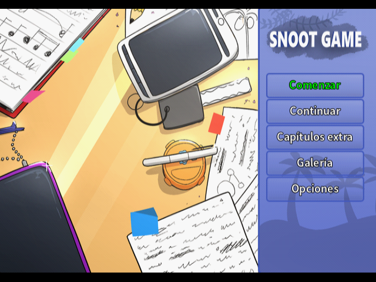
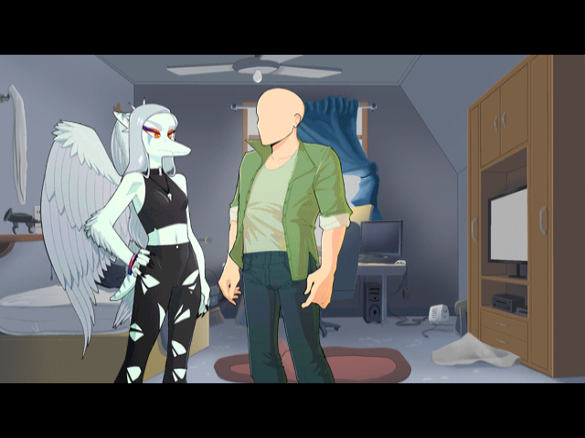
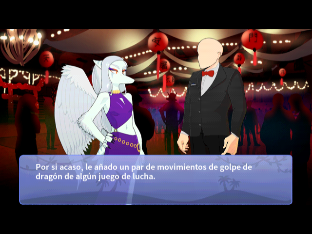
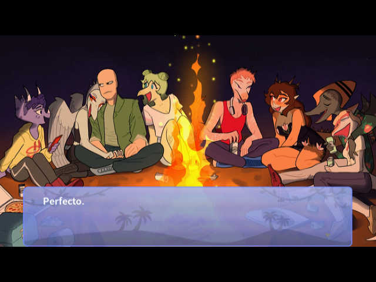
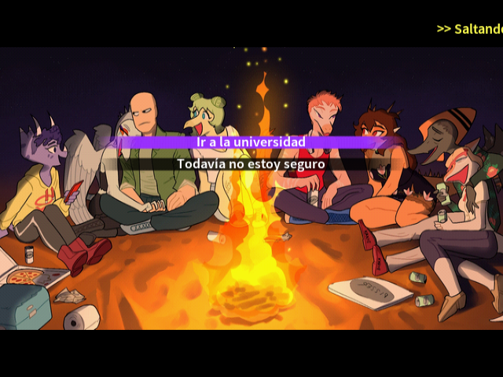
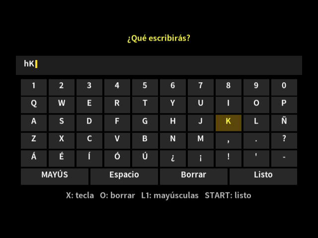

<div align="center">

# Snoot Game para PS2

**Port no oficial en español para PlayStation 2**

Hecho por **Pako Tako** · Adaptado directamente desde el código fuente original de Snoot Game


[Capturas](#capturas) · [Instalación](#instalación) · [Controles](#controles) · [Compilar](#compilar-desde-el-código) · [Selector de desarrollo](#selector-de-capítulos-para-desarrolladores)

[⬇️ Descargar la ISO y el paquete USB](https://github.com/FranciscoCV2707/snoot-game-ps2/releases/latest)

</div>

---

## El proyecto

Una adaptación nativa de **Snoot Game** para PlayStation 2. El juego se compila desde el código fuente original de Ren'Py y genera sus propios recursos para PS2: imágenes a 640×360, música Ogg Vorbis y la fuente del juego. No depende del port de PS1 ni reutiliza sus gráficos reducidos.

La historia completa, las cuatro rutas y los capítulos extra pasan las mismas pruebas automáticas que comparan el recorrido contra el juego original.

> Este port es un proyecto de fans. Las capturas son del build ejecutado en PCSX2; todavía falta validarlo en una PS2 física.

## Capturas

<p align="center">
  
  
  <br><sub>Menú principal y una escena del capítulo 1.</sub>
</p>

<p align="center">
  
  
  <br><sub>Escenas con diálogo, a la resolución de la PS2.</sub>
</p>

<p align="center">
  
  
  <br><sub>Elecciones y el teclado en pantalla, manejados con el mando.</sub>
</p>

## Qué incluye

- Historia completa en español, con las cuatro rutas y los capítulos extra; las imágenes opcionales están activadas.
- Arte del juego original convertido a 640×360, con la escena en 16:9 y proporción corregida para televisores 4:3.
- Música y efectos en Ogg Vorbis, decodificados en la consola a 60 fps.
- El teléfono y el teclado en pantalla del capítulo 13D, adaptados al mando.
- Guardado en la Memory Card (`mc0:/SNOOTGAME`) con ícono propio, galería y opciones.
- Arranque desde memoria USB (FreeMcBoot + uLaunchELF), desde OPL o grabado en disco.

## Instalación

Descarga los archivos de la sección **[Releases](https://github.com/FranciscoCV2707/snoot-game-ps2/releases/latest)**.

**Memoria USB (FreeMcBoot):**

1. Formatea una memoria USB en FAT32.
2. Extrae `SnootGame-PS2-USB-v1.0.0.zip` y copia la carpeta `SNOOT` a la raíz de la memoria.
3. En la PS2, abre uLaunchELF y ejecuta `mass:/SNOOT/snoot.elf`.

**ISO (OPL o disco):**

- Con Open PS2 Loader, copia `SnootGame-PS2-v1.0.0.iso` a la carpeta `DVD` de tu USB o disco duro.
- En PCSX2, abre la ISO desde **Sistema → Iniciar archivo**. También puede grabarse en un DVD para consolas que ejecuten discos sin licencia.

Para guardar partidas hace falta una Memory Card formateada en la ranura 1.

## Controles

| Mando de PS2 | Acción |
|:---:|---|
| ✕ | Aceptar y avanzar el texto |
| ◯ | Volver o cancelar |
| Cruceta / stick izquierdo | Navegar y elegir (el stick funciona en modo analógico) |
| START | Abrir la pausa, guardar y cargar |
| R1 | Saltar texto ya leído |
| □ | Ocultar o mostrar la caja de diálogo |

**Teclado del capítulo 13D:** ✕ escribe la tecla, ◯ borra, L1 cambia a mayúsculas y START termina.
**Teléfono:** la cruceta desplaza los mensajes y R1 acelera el desplazamiento.

## Selector de capítulos para desarrolladores

El port incluye un menú de prueba oculto para iniciar directamente la historia o un capítulo:

1. Ve a la pantalla del título.
2. Mantén presionados **L1 + R1**.
3. Sin soltarlos, pulsa **SELECT**.
4. Elige con la cruceta y pulsa **✕** para iniciar. **◯** vuelve al título.

El menú se llama **"Menú de capítulos (desarrollo)"** y no aparece entre las opciones normales.

## Compilar desde el código

### Requisitos

- Windows 10/11 y Python 3.12.
- Docker Desktop para el toolchain `ps2dev/ps2dev` (la imagen está fijada por digest en `platforms/ps2/build.py`).
- FFmpeg, con `ffmpeg` y `ffprobe` en `PATH`.
- Una copia del juego original. El repositorio busca `E:\snoot\snootgame\game` por defecto; la variable `SNOOT_SOURCE` indica otra ubicación.

El repositorio no contiene los guiones, imágenes, música ni demás archivos del juego original. Debes tenerlos localmente para generar los datos.

### Pasos (PowerShell)

```powershell
py -3.12 -m venv .venv
.\.venv\Scripts\Activate.ps1
python -m pip install -r requirements.txt

# Genera los datos de PS2 desde el juego original y compila el ELF
python platforms\ps2\build.py

# Arma la carpeta para USB y la ISO
python platforms\ps2\package.py
```

El ejecutable queda en `build/ps2/snoot.elf`; la carpeta para USB en `dist/ps2/usb/SNOOT` y la imagen en `dist/ps2/SnootGame-PS2.iso`. La guía de [compilación para PS2](docs/platforms/ps2.md) documenta el toolchain, el arranque en consola real, el guardado y las pruebas en PCSX2.

## Créditos y licencias

**Port para PS2:** Pako Tako.

**Juego original, historia, arte, música y traducción:** Cavemanon y colaboradores. Snoot Game pertenece a sus autores originales. Este port no es oficial ni está afiliado con Cavemanon o Sony.

Consulta [`CREDITS.md`](CREDITS.md) y [`docs/licencias.md`](docs/licencias.md) para los créditos y requisitos de distribución.

---

<div align="center"><sub>Proyecto de fans · El juego original pertenece a sus respectivos autores.</sub></div>
